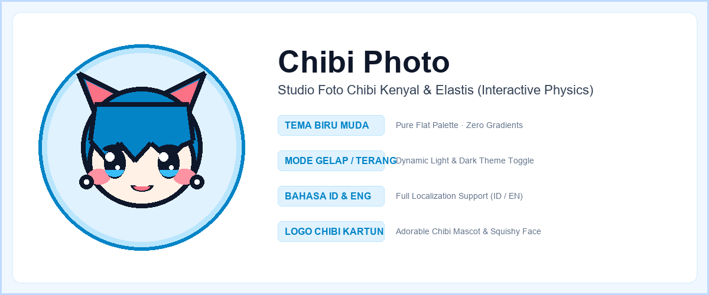

<p align="center">
  
</p>

<p align="center">
  <strong>Studio foto chibi kenyal & interaktif berbasis fisika mesh pegas elastis di Android.</strong><br>
  <em>Interactive 2D spring-damper mesh studio for chibi art, characters, and squishy portraits on Android.</em>
</p>

<p align="center">
  <a href="https://github.com/DimNih/chibi-photo-android/releases"></a>
  <a href="LICENSE"></a>
  <a href="https://kotlinlang.org/"></a>
  <a href="https://developer.android.com/compose"></a>
  <a href="https://developer.android.com/"></a>
  <a href="https://github.com/DimNih/chibi-photo-android/stargazers"></a>
</p>

---

## Fitur Utama / Key Features

- 🎨 **Tema Biru Muda (Pure Flat Light Blue):** Desain bersih bebas *AI-slop*, tanpa gradien (*zero gradients*), palet solid bernuansa biru muda cerah dengan garis batas tipis presisi 1.dp.
- ☀️/🌙 **Mode Gelap & Terang (Dark & Light Mode):** Pergantian instan antara tema *Light Ice Blue* (`#F0F7FF`) yang sejuk dan *Dark Midnight Slate* (`#0B162A`).
- 🇮🇩/🇬🇧 **Dukungan Dua Bahasa (Indonesian & English):** Beralih bahasa (`ID` / `EN`) secara instan kapan saja langsung dari bilah atas aplikasi.
- 🐱 **Logo Kartun Chibi Asli:** Ikon maskot kartun chibi yang imut dengan mata anime berbinar, rona pipi squishy, dan tangan kecil yang sedang mencubit pipi.
- ⚡ **Engine Fisika 240 Hz:** Simulasi mesh pegas-peredam *symplectic* 33x33 berkecepatan tinggi dengan respons pantulan alami dan efek rona wajah dinamis saat ditarik (*reactive strain blush*).
- 🎵 **Sintesis Audio Prosedural 44.1 kHz:** Suara kenyal (*squish & bounce*) dihasilkan secara real-time via PCM AudioTrack tanpa aset suara eksternal.
- 🎬 **Perekam GIF & Foto Instan:** Rekam animasi goyangan chibi ke format GIF berulang (*infinite loop*) atau simpan foto resolusi penuh ke galeri.

---

## Arsitektur Sistem / Architecture

```
               +---------------------------------------------------+
               |             Chibi Photo Compose UI                |
               |       Theme (Light / Dark) · Lang (ID / EN)       |
               +---------+---------------+---------------+---------+
                         |               |               |
           Multi-Touch & |               | Accelerometer | Frame Capture
           Mirror-X Mask |               | (Device Tilt) | (25 FPS Stream)
                         v               v               v
       +-----------------+---------------+---+   +-------+-----------------+
       |       MochiMeshEngine (240 Hz)      |   |    GifEncoder (LZW)     |
       |   33x33 Symplectic Spring Lattice   |   |  & MediaStore Exporter  |
       +-----------------+-------------------+   +-------------------------+
                         |
           +-------------+-------------+
           |                           |
           v (drawBitmapMesh)          v (Velocity / Strain)
+----------+--------------+   +--------+------------------+
|  Hardware GPU Canvas    |   |  ProceduralAudioEngine    |
|  + Flat Blush & Specular|   |  44.1 kHz PCM AudioTrack  |
+-------------------------+   +---------------------------+
```

---

## Alat & Kontrol Studio / Studio Controls

### 1. Alat Sentuh / Touch Tools (`Sentuh` / `Touch`)

- **Cubit / Pinch:** Tarik dan renggangkan pipi dengan sentuhan multi-touch dan recoil pegas elastis saat dilepas.
- **Tusuk / Poke:** Tekan permukaan untuk membuat lekukan ke dalam dan memicu riak gelombang ke luar.
- **Putar / Swirl:** Puntir dan putar simpul di sekitar titik sentuhan dengan torsi pegas rotasi.
- **Denyut / Pulse:** Goyangan otomatis berulang mengikuti tempo ketukan (`60–180 BPM`) untuk perekaman GIF.
- **Gravitasi / Gravity:** Miringkan atau goyangkan HP untuk menggerakkan bagian elastis menggunakan sensor akselerometer.

### 2. Topeng Simetris / Masking (`Topeng` / `Mask`)

Warnai atau hapus area elastis langsung di atas kanvas:
- **Simetri Kanan-Kiri (Mirror-X):** Mengoles pipi kiri otomatis merefleksikan sapuan ke pipi kanan secara simetris.
- **Pola Instan:** `Kedua Pipi`, `Pusat Inti`, `Puncak Kepala`, `Seluruh Layar`, atau `Hapus Semua`.

### 3. Karakteristik Bahan / Materials (`Pantulan` / `Bounce`)

| Bahan / Preset  | Frekuensi ($f$) | Redaman ($\zeta$) | Kelenturan | Karakter Pantulan                 |
| :-------------- | :-------------- | :---------------- | :--------- | :-------------------------------- |
| **Gel Lembut**  | `6.8 Hz`        | `0.13`            | `95%`      | Goyangan pipi kenyal lembut       |
| **Tetes Air**   | `5.2 Hz`        | `0.08`            | `94%`      | Riak gelombang berulang           |
| **Karet Elastis**| `11.2 Hz`      | `0.11`            | `84%`      | Tegangan kencang & cepat kembali  |
| **Adonan Hangat**| `4.6 Hz`       | `0.28`            | `98%`      | Empuk mantap & rebound berbobot   |
| **Busa Memori** | `3.2 Hz`        | `0.62`            | `82%`      | Kembali perlahan tanpa pantulan   |

---

## Build Produksi & Instalasi / Production Build

Proyek ini telah dikonfigurasi dengan minifikasi **R8**, pemotongan sumber daya (*resource shrinking*), dan penandatanganan rilis V1/V2/V3:

```powershell
# Windows PowerShell
$env:JAVA_HOME = 'C:\Program Files\Microsoft\jdk-21.0.13.102-hotspot'
.\gradlew.bat assembleRelease

# Linux / macOS
./gradlew assembleRelease
```

File APK siap pakai:
- `dist/ChibiPhoto-v1.0.0-release.apk` *(~916 KB)*
- `app/build/outputs/apk/release/ChibiPhoto-v1.0.0-release.apk`

Pasang langsung ke perangkat Android:
```bash
adb install -r dist/ChibiPhoto-v1.0.0-release.apk
```

---

## Lisensi / License

Didistribusikan di bawah lisensi [MIT License](LICENSE).
