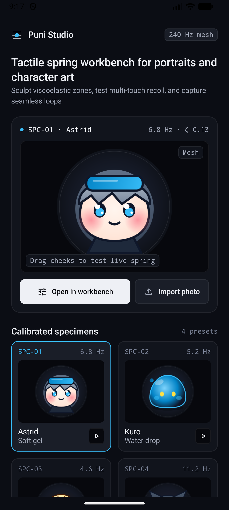
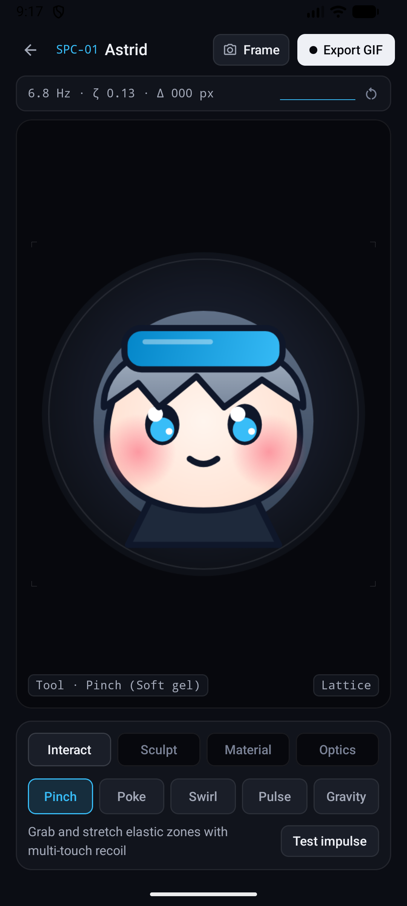
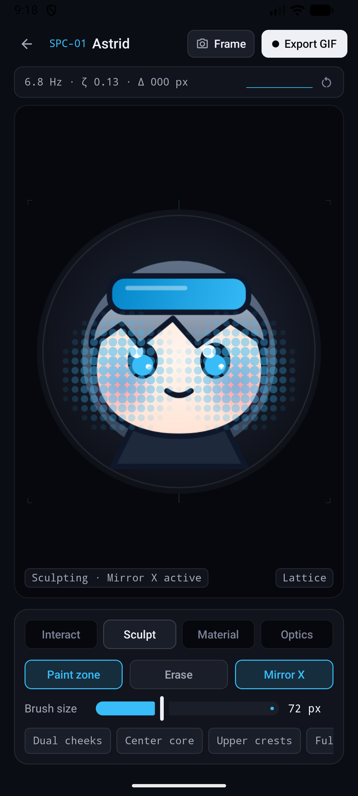
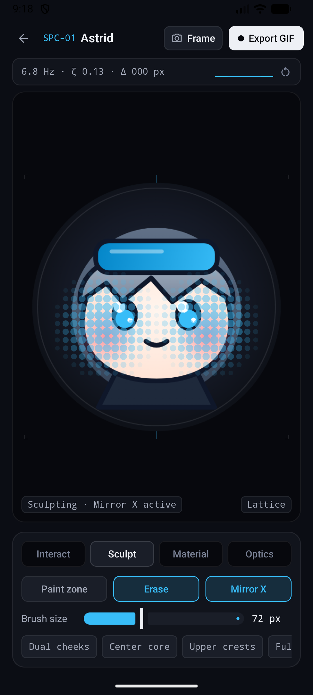

<p align="center">
  
</p>

<p align="center">
  <strong>Interactive 2D spring-damper mesh studio for chibi art and portraits on Android.</strong>
</p>

<p align="center">
  <a href="https://github.com/DimNih/chibi-photo-android/releases"></a>
  <a href="LICENSE"></a>
  <a href="https://kotlinlang.org/"></a>
  <a href="https://developer.android.com/compose"></a>
  <a href="https://developer.android.com/"></a>
  <a href="https://github.com/DimNih/chibi-photo-android/stargazers"></a>
</p>

---

## Overview

**Chibi Photo** turns 2D chibi drawings, character portraits, and photos into interactive elastic surfaces on Android.

It runs a **240 Hz sub-stepped harmonic spring-damper mesh** rendered directly on the GPU canvas alongside a **44.1 kHz procedural PCM audio engine**:

1. **Live Character Stage:** Test touch-recoil physics directly on the home screen or import custom photos from your gallery.
2. **4-Tab Studio Workbench:** Switch between 5 touch tools (`Pinch`, `Poke`, `Swirl`, `Pulse`, `Tilt`), symmetrical `Mirror-X` mask painting, bounce calibration, and GIF/PNG export.

---

## Architecture

```
               +---------------------------------------------------+
               |             Chibi Photo Compose UI                |
               |     (Home Stage / 4-Tab Studio Workbench)         |
               +---------+---------------+---------------+---------+
                         |               |               |
           Multi-Touch & |               | Accelerometer | Frame Capture
           Mirror-X Mask |               | (Device Tilt) | (25 FPS Stream)
                         v               v               v
       +-----------------+---------------+---+   +-------+-----------------+
       |       MochiMeshEngine (240 Hz)      |   |    GifEncoder (LZW)     |
       |   33x33 Symplectic Spring Lattice   |   |  & MediaStore Exporter  |
       +-----------------+-------------------+   +-------------------------+
                         |
           +-------------+-------------+
           |                           |
           v (drawBitmapMesh)          v (Velocity / Strain)
+----------+--------------+   +--------+------------------+
|  Hardware GPU Canvas    |   |  ProceduralAudioEngine    |
|  + Flat Cel Blush & 3D  |   |  44.1 kHz PCM AudioTrack  |
+-------------------------+   +---------------------------+
```

---

## Operating Modes

### 1. Touch Tools (`Touch` Tab)

- **Pinch:** Pull elastic zones with multi-touch support and high-velocity spring recoil upon release.
- **Poke:** Tap or press to push vertices outward and trigger radial shockwave ripples.
- **Swirl:** Twist vertices around the touch point with rotational spring torque.
- **Pulse:** Auto-bounce active zones to a configurable tempo (`60–180 BPM`) for hands-free GIF recording.
- **Gravity:** Tilt or shake your phone to sway elastic zones using the hardware accelerometer.

### 2. Symmetrical Masking (`Mask` Tab)

Paint or erase elasticity weights directly over the live character canvas:

- **Mirror-X:** Painting one cheek mirrors strokes across the center axis automatically.
- **Quick Templates:** Apply `Dual cheeks`, `Center core`, `Upper crests`, `Full canvas`, or `Clear all` in one tap.

### 3. Material Presets (`Bounce` Tab)

| Preset          | Frequency ($f$) | Damping ($\zeta$) | Stretch | Response                           |
| :-------------- | :-------------- | :---------------- | :------ | :--------------------------------- |
| **Soft gel**    | `6.8 Hz`        | `0.13`            | `95%`   | Multi-cycle chibi cheek bounce     |
| **Water drop**  | `5.2 Hz`        | `0.08`            | `94%`   | Low-damping ripple wave            |
| **Latex snap**  | `11.2 Hz`       | `0.11`            | `84%`   | Fast, high-tension vibration       |
| **Warm dough**  | `4.6 Hz`        | `0.28`            | `98%`   | Soft, heavy mochi rebound          |
| **Memory foam** | `3.2 Hz`        | `0.62`            | `82%`   | Slow viscous return without bounce |

---

## Studio Preview

| Home Stage | Touch Workbench |
| :---: | :---: |
|  |  |
| **Mirror-X Masking** | **Bounce Calibration** |
|  |  |

---

## Quickstart & Production Build

### 1. Build Signed Release APK

The project is configured with R8 minification, resource shrinking, and V1/V2/V3 release signing:

```powershell
# Windows PowerShell
.\gradlew.bat assembleRelease

# macOS / Linux
./gradlew assembleRelease
```

Output location:

```text
dist/ChibiPhoto-v1.0.0-release.apk
app/build/outputs/apk/release/ChibiPhoto-v1.0.0-release.apk
```

### 2. Install to Android Device

```bash
adb install -r dist/ChibiPhoto-v1.0.0-release.apk
```

---

## Engine Parameters

| Parameter           | Default    | Range            | Description                                              |
| :------------------ | :--------- | :--------------- | :------------------------------------------------------- |
| `meshWidth / Height`| `32 x 32`  | `16 .. 64`       | Vertex grid resolution (`1,089` active vertices)         |
| `wobbleFrequency`   | `6.8 Hz`   | `3.0 .. 14.0 Hz` | Spring oscillation speed ($f$)                           |
| `dampingZeta`       | `0.13`     | `0.06 .. 0.65`   | Damping ratio ($\zeta$); lower values bounce more times  |
| `softness`          | `0.95`     | `0.35 .. 1.00`   | Maximum elastic stretch multiplier                       |
| `pulseBpm`          | `116 BPM`  | `60 .. 180 BPM`  | Auto-oscillation tempo in `Pulse` mode                   |

---

## License

Distributed under the [MIT License](LICENSE).

